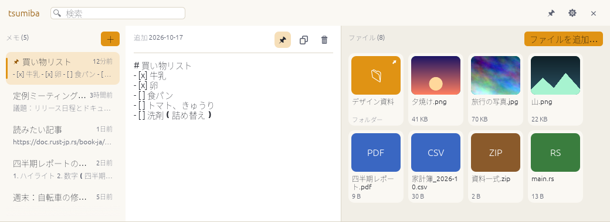

# tsumiba

[](https://github.com/hjosugi/tsumiba/actions/workflows/ci.yml)
[](https://github.com/hjosugi/tsumiba/releases/latest)
[](LICENSE)

**メモとファイルを、画面の端にひと積み。** tsumiba(積み場)は、画面の上端から
すっと降りてくる、メモとファイルの置き場です。**Windows・macOS・Linux** で動きます。
[English](README.md) | 日本語

<p align="center">
  <picture>
    <source media="(prefers-color-scheme: dark)" srcset="docs-site/landing/screenshots/main-dark-ja.png">
    
  </picture>
</p>

ポインターを画面の上端に寄せる(またはショートカットを押す)と置き場が降りてきます。
メモを書く、ファイルを放り込む、元の作業に戻る。用が済めば自分で引っ込み、
隠れている間は何も消費しません。

[Unclutter](https://unclutterapp.com/) のいちばん使われる部分を、Rust ですべての
デスクトップ向けに作り直したものです。**メモとファイルだけ**(クリップボード履歴は
ありません)に絞り、見ているページ・選択範囲・リンク・画像を置き場に送る
**ブラウザ拡張**を加えました。

- **メモ** — プレーンな Markdown ファイル。入力すると自動保存、検索・ピン留め可。
  開いた瞬間は空のメモなので、そのまま書き始められます。
- **ファイル** — 何でもドロップ。コピーを保存するか、元の場所を覚えるだけにするかを
  選べます。画像はサムネイル表示、右クリックから開く・フォルダーで表示・コピー・
  別名で保存。削除したものは 30 日間ゴミ箱に残ります。
- **ブラウザ拡張** — Chrome・Edge・Brave・Firefox。右クリック →「tsumiba に送る」、
  またはポップアップからすばやくメモ。
- **コマンドライン** — `tsumiba note "牛乳を買う"`、`tsumiba add report.pdf`、
  `tsumiba list --json`。アプリが動いていなくても使えます。
- **ローカルで完結** — アカウントもクラウドもテレメトリーもなし。待ち受けるのは
  トークンで守られた `127.0.0.1` だけです。
- **日本語・英語 UI**、ライト/ダークテーマ。

ドキュメント: **<https://hjosugi.github.io/tsumiba/ja/>**

## インストール

[最新リリース](https://github.com/hjosugi/tsumiba/releases/latest)からダウンロードするか、
インストーラースクリプトを使います。

### Windows

```powershell
irm https://raw.githubusercontent.com/hjosugi/tsumiba/main/scripts/install.ps1 | iex
```

または `tsumiba-<version>-windows-x86_64.zip` を好きな場所に展開して `tsumiba.exe`
を実行します。コード署名はまだなので、初回は SmartScreen の確認が出ます。

### macOS

```sh
curl -fsSL https://raw.githubusercontent.com/hjosugi/tsumiba/main/scripts/install.sh | sh
```

または `.dmg` を開いて **Tsumiba** を Applications にドラッグします。アドホック署名
のみで公証はしていないため、初回は右クリック →「開く」(または
`xattr -dr com.apple.quarantine /Applications/Tsumiba.app`)が必要です。
Apple Silicon と Intel の両方に対応するユニバーサルビルドです。

### Linux

```sh
curl -fsSL https://raw.githubusercontent.com/hjosugi/tsumiba/main/scripts/install.sh | sh
```

`~/.local` にインストールします(root 不要)。または
`tsumiba-<version>-linux-<arch>.tar.gz` を展開して `install.sh` を実行します。
Nix なら `nix run github:hjosugi/tsumiba`。

Wayland ではアプリがポインターを監視することも、キーを横取りすることもできない
ため、デスクトップのキーボード設定で `tsumiba toggle` をキーに割り当ててください。
詳しくは[プラットフォームについて](#プラットフォームについて)を参照。

### ソースからビルド

Rust 1.92 以降。

```sh
cargo build --release          # target/release/tsumiba
cargo test --workspace
```

Linux では `pkg-config` と、`libxcb`・`libxkbcommon`・`libx11`・`wayland` の開発
ファイルが必要です。`nix develop` で、GUI 検証用の仮想ディスプレイを含めて一式
そろいます。

## 使い方

| やりたいこと | 操作 |
| --- | --- |
| 置き場を開く | ポインターを**画面の上端**に置く / **Ctrl+Alt+Space** / トレイアイコンをクリック / `tsumiba toggle` |
| ドラッグ中に開く | ファイルを上端までドラッグ(すぐ開きます) |
| メモを書く | そのまま入力。止めて 0.5 秒後に保存されます |
| ファイルを追加 | ファイル側にドロップ、または **ファイルを追加…** |
| 検索 | **Ctrl/⌘+F** で入力。メモとファイルを同時に絞り込みます |
| 開いたままにする | ヘッダーのピンボタン |
| 隠す | **Esc** / ポインターを外す / もう一度ショートカット |
| 設定 | 歯車ボタン(**Ctrl/⌘+,**)または `config.toml` |

ポインターを上端に 0.25 秒置くと開きます。反応するのは上端の中央部分(パネルと同じ幅)
だけなので、ウィンドウのタイトルバーやブラウザのタブに手を伸ばしても誤作動しません。

## ブラウザ拡張

Chrome・Edge・Brave・Firefox(Manifest V3)。リリースから
`tsumiba-extension-chrome-<version>.zip` または `...-firefox-<version>.zip` を取得して
読み込み、`tsumiba token`(または **設定 → ブラウザ拡張 → コピー**)のトークンで
一度だけペアリングします。権限の用途などの詳細は
[extension/README.md](extension/README.md) と
[ドキュメント](https://hjosugi.github.io/tsumiba/ja/browser-extension.html)にあります。

## コマンドライン

```sh
tsumiba                       # 置き場を開く(未起動なら起動)
tsumiba toggle                # 表示/非表示。Wayland ではこれをキーに割り当てる
tsumiba note "牛乳を買う"      # または: echo "牛乳を買う" | tsumiba note
tsumiba add report.pdf photos/    # コピーして追加。--link なら場所だけ記憶
tsumiba list --json
tsumiba token                 # ブラウザ拡張のペアリング用
tsumiba --help
```

tsumiba が起動していればそれ経由で処理するのでウィンドウも最新になり、起動して
いなければファイルを直接操作します。スクリプトや SSH 越しでも使えます。

## データの場所

| | Linux | macOS | Windows |
| --- | --- | --- | --- |
| メモとファイル | `~/.local/share/tsumiba` | `~/Library/Application Support/io.github.hjosugi.tsumiba` | `%APPDATA%\hjosugi\tsumiba\data` |
| 設定・トークン | `~/.config/tsumiba` | 同上 | `%APPDATA%\hjosugi\tsumiba\config` |

メモは `notes/<id>.md`、ファイルは `files/<id>/<name>` に置かれます。どちらも普通の
ファイルなので、バックアップ・同期・grep ができます。`tsumiba paths` で正確な場所を
表示でき、`TSUMIBA_HOME` で丸ごと移動できます。

## プラットフォームについて

検証できていること・できていないことを正直に書きます。

| | Windows | macOS | Linux (X11) | Linux (Wayland) |
| --- | --- | --- | --- | --- |
| ビルド・lint・単体/API/CLI テスト | CI | CI | CI | CI |
| 実アプリが起動し、ウィンドウループが回り、CLI に応答して終了する | **CI**(`scripts/smoke-gui-windows.ps1`。GitHub の GPU の無いランナーで OpenGL が失敗し、wgpu のフォールバックが動作) | **CI**(`scripts/smoke-gui-macos.sh`、GitHub のランナー上) | **CI**、および Xvfb 上の出現/消去/入力の確認(`scripts/smoke-gui-linux.sh`) | 未確認 |
| ウィンドウ位置・上端トリガー・ショートカット・端へのドラッグ・トレイ | 実装済み、**実機では未検証** | 実装済み、**実機では未検証** | **Xvfb 上で検証済み**(実際のデスクトップ環境ではない) | 通常のウィンドウとして表示(実装済み、**実際のコンポジターでは未確認**)。上端トリガーとショートカットは Wayland の仕様上不可 |

未対応: 置き場から他のアプリへファイルを**ドラッグで取り出す**操作(GUI ツールキットが
ネイティブのドラッグを開始できないため。当面は「フォルダーで表示」「ファイルをコピー」
「コピーを保存」を使ってください)、コード署名、ストアやパッケージマネージャーへの登録。

## コントリビュート

[CONTRIBUTING.md](CONTRIBUTING.md) を参照してください。`tsumiba paths` の出力と
ログファイルを添えた不具合報告がいちばん助かります。

## 先行事例とクレジット

- [Unclutter](https://unclutterapp.com/)(Softwarebay)— 発想の元。画面上端のパネルに
  メモとファイル。macOS 専用・クローズドソース。
- [yeet](https://github.com/hjosugi/yeet) — Wayland/Windows 向けのドラッグ&ドロップ
  置き場。このプロジェクトのパッケージングやドキュメントの流儀の出どころです。
- [Yoink](https://eternalstorms.at/yoink/mac/)、[DropPoint](https://github.com/GameGodS3/DropPoint)、
  [dragon](https://github.com/mwh/dragon) — ほかのファイル置き場の実装。

## ライセンス

MIT — [LICENSE](LICENSE) を参照。
